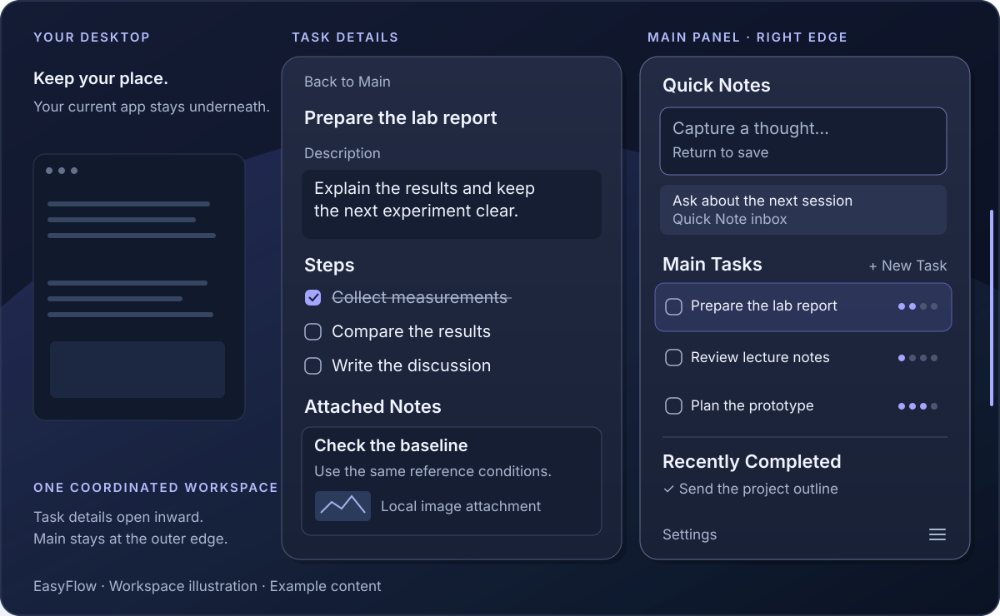

  

<h1 align="center">EasyFlow</h1>

<strong>Your current work, one movement away.</strong>

A native macOS edge workspace for quick notes, active tasks, and the context behind them.

  <a href="https://github.com/Natizh/EasyFlow/releases/latest"><strong>Download for macOS</strong></a> ·
  <a href="https://natizh.github.io/EasyFlow/">Website</a> ·
  <a href="docs/README.md">Documentation</a> ·
  <a href="#a-note-from-the-creator">A note from the creator</a>

macOS 14+ · Free and open source · MIT licensed · No EasyFlow account

Workspace illustration with example content; not an app screenshot. Right-side layout shown; Left is also available.

EasyFlow keeps the small, active layer of your work close to the app you are already using. Hold the pointer briefly at your chosen outer desktop edge to reveal it. Capture a thought, check the next task, or open its details, then return to your work.

It runs without a Dock icon or menu-bar item. The workspace overlays your current app, including fullscreen apps, without resizing it.

## Why EasyFlow

| When you need to… | EasyFlow helps you… |
| --- | --- |
| Save a thought before it disappears | Type a Quick Note and press Return; paste screenshots or images alongside the text. |
| See what comes next | Drag Main Tasks into priority order. Estimate effort separately, from 1 to 4. |
| Keep context beside a task | Open its Description, one-level Steps, and Attached Notes in the inward panel. |
| Organize a captured note | Drag it onto a task to move the same note, including its images, into Attached Notes. |
| Return to unfinished work | Use optional internal reminder banners with frequency, pause, and per-task controls. |
| Make the workspace feel at home | Choose Left or Right, panel dimensions, row density, and native appearance. |

Standard and Frosted appearances work on macOS 14+. Optional Liquid Glass requires macOS 26.

## Install

1. Download **EasyFlow.zip** from the [latest release](https://github.com/Natizh/EasyFlow/releases/latest).
2. Extract it and move **EasyFlow.app** to **Applications**.
3. Open EasyFlow. Allow Reminders access if you want Main Task synchronization; the local workspace also works without it.
4. Reveal the workspace at the rightmost outer desktop edge. Open the Settings gear to change sides or enable **Launch at Login**.

**First launch:** the community app is ad-hoc signed and is not Apple Developer ID signed or notarized. If macOS blocks it, use **System Settings → Privacy & Security → Open Anyway** for EasyFlow, then confirm the prompt. See the [installation guide](docs/INSTALLATION.md#first-launch-and-macos-security) for the full steps.

**Updates:** v1.5.0 introduced signed in-app updates. Install that release or a newer public build manually first; subsequent verified releases can be installed from Settings. Update signing is separate from Apple notarization.

[Installation, updates, and removal](docs/INSTALLATION.md) · [Build from source](CONTRIBUTING.md#build-and-run)

## Your first minute

1. **Capture:** reveal EasyFlow, type a Quick Note, and press Return. The composer clears for your next thought.
2. **Choose:** select **New Task**, enter a title, and press Return. Effort starts at 1; choose 2–4 first if needed.
3. **Break it down:** hover or open the task to edit its Description, add Steps, and keep notes beside it.
4. **Organize:** drag tasks and Steps into order; drag a Quick Note onto a task to attach it.
5. **Finish:** check a Step to keep it visible in place, or complete a Main Task to move it into Recently Completed.

Recently Completed shows the five latest completions. **There is currently no restore or uncomplete action.**

The [user guide](docs/USER_GUIDE.md) covers keyboard controls, images, reminders, panel settings, and daily workflows.

## Local workspace, focused sync

EasyFlow uses one dedicated **EasyFlow** list in Apple Reminders. After permission is granted, it creates that list if needed or reuses an unambiguous writable match.

| Synchronized through Apple Reminders | Stored locally by EasyFlow |
| --- | --- |
| Main Task title | Task order and effort |
| Main Task completion | Descriptions, Steps, and Step state |
| Main Task creation and deletion | Quick Notes, Attached Notes, and images |
| | Formatting, panel preferences, and internal reminder settings |

The Main Task core can reach your other devices through Apple Reminders when its list is in a syncing account. The rest of the workspace stays on this Mac; Reminders is not a backup of those local details.

EasyFlow has no account system, custom backend, telemetry, or analytics. Public builds contact GitHub to check for and download app updates; automatic checks can be disabled in Settings. [Sync and data details](docs/REMINDERS_SYNC.md) · [Update verification](docs/UPDATES.md)

## Documentation

Start with the [documentation index](docs/README.md) for the full reading map.

| For | Read |
| --- | --- |
| Installing or updating | [Installation](docs/INSTALLATION.md) |
| Using the workspace | [User guide](docs/USER_GUIDE.md) |
| Fixing a problem | [Troubleshooting](docs/TROUBLESHOOTING.md) |
| Building or contributing | [Contributor guide](CONTRIBUTING.md) |
| Understanding the product | [Product specification](PRODUCT_SPEC.md) and [UX behavior](docs/UX_BEHAVIOR.md) |
| Understanding the implementation | [Architecture](docs/ARCHITECTURE.md), [data model](docs/DATA_MODEL.md), and [Reminders sync](docs/REMINDERS_SYNC.md) |
| Reviewing releases | [Release notes](docs/releases/README.md) and [signed updates](docs/UPDATES.md) |

## A note from the creator

I am a university student, not a software developer. EasyFlow started because I needed this kind of tool in my own daily work and could not find one that behaved the way I wanted.

I did not personally write the implementation code. My contribution was defining the product: the original idea, project planning and organization, user stories, requirements, interaction details, UX and visual direction, testing decisions, and the many rounds of feedback that shaped the result. I used AI tools to turn that specification into the working macOS application in this repository. The website was created through the same process.

This project is also an honest experiment about the period we are living through. For a product like this, being able to define a problem clearly, communicate with AI, evaluate its output, identify mistakes, and keep iterating was more useful to me than already knowing how to write every line of code myself. That does not make software engineering unimportant; it shows that the ability to direct AI effectively is becoming a real and increasingly important way to build software.

I am not selling EasyFlow, and I do not want to hide or apologize for the fact that it was built with AI. I made it to practice this new way of creating, to keep training my ability to work with AI, and because EasyFlow is genuinely useful to me every day. If it can also be useful to somebody else, even better.

## License

EasyFlow is available under the [MIT License](LICENSE).
