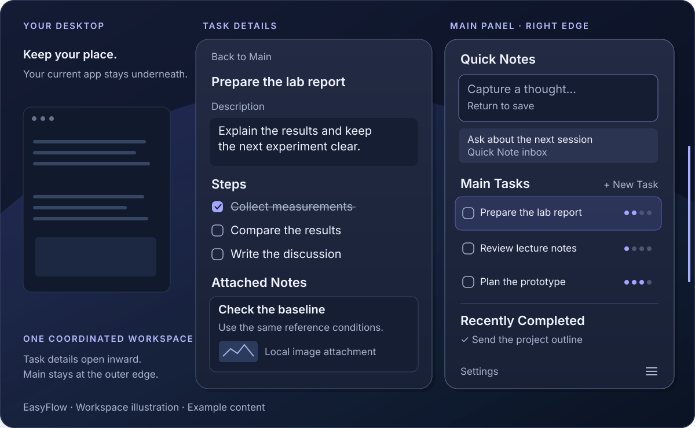

# Use EasyFlow

[Documentation](README.md) · [Installation](INSTALLATION.md) · [Troubleshooting](TROUBLESHOOTING.md)

EasyFlow is for the work in front of you: a few active tasks, the next Steps, and thoughts you want to keep. It uses a Main Panel at the desktop edge and one contextual Secondary Panel immediately inward.

## Reveal your workspace

Hold the pointer at the selected outer desktop edge for about **300 ms**. Right is the default. Left uses the far-left display; Right uses the far-right display. Internal display seams do not activate EasyFlow.

The panels overlay the current app, including native fullscreen apps, without moving or resizing it. Move away to dismiss after pointer interaction. Keyboard editing keeps the workspace engaged; Escape dismisses the workspace. You can also reopen EasyFlow from Finder or Spotlight to reach it with the keyboard.

*Illustration with example content; not a screenshot. The layout mirrors when Panel Side is Left.*

## Capture a Quick Note

1. Reveal EasyFlow; the Quick Note composer is ready to type into.
2. Write your thought, or paste an image or screenshot with **Command-V**.
3. Press **Return** to save it and clear the composer for the next note.

Quick capture uses Return to submit, rather than insert a newline. Open a saved note in the notes browser for longer editing. A non-empty draft is also saved when capture loses focus or the panel closes; an interrupted persisted draft is recovered on relaunch.

Quick Notes can contain text, images, or both. Click an image thumbnail to open a larger preview; Escape or Command-W closes it. Descriptions and Step notes do not accept image attachments.

## Create and order Main Tasks

Select **New Task**, enter a title, then press Return. New tasks start with effort **1**; choose another value from **1–4** before adding if needed. Tasks imported from Apple Reminders show **?** until you assign effort locally.

Drag tasks into the order you intend to work on them. **Position is priority; effort estimates the work required.** Effort does not set priority or alter the corresponding Reminder.

Hover or open a task to show its details in the Secondary Panel. Switching tasks updates that same panel in place.

## Keep the context with the task

| Area | Use it for |
| --- | --- |
| Description | The task's purpose, context, and intended execution. |
| Steps | One-level actions in priority order, each with optional text notes. |
| Attached Notes | Distinct notes and images that belong beside this task. |

Drag a Quick Note onto a Main Task to move it into Attached Notes. The note leaves the inbox and keeps its text and images; it is not copied or appended to the Description. Note menus also provide attachment actions for keyboard use.

Drag Steps to reorder them. Completing a Step dims it and keeps it in its existing position. Task and Step menus offer local styling and move actions.

## Complete work deliberately

Completing a Main Task removes it from the active list, completes its linked Reminder, and places it in **Recently Completed**. This view shows the five latest completed tasks; older completed history is retained locally.

**There is no restore or uncomplete action in the current version.** Uncompleting its Reminder externally does not restore it in EasyFlow; synchronization completes that Reminder again.

Deleting a Main Task also deletes its linked Reminder. The five newest deleted Main Tasks are retained internally, but there is no Trash or restore interface. Deletion is not a user-facing archive workflow.

## Use task reminders

EasyFlow's optional reminders are **internal banners**, separate from Apple Reminders sync and macOS Notification Center. When enabled, a banner points you back to the first eligible active task in your EasyFlow order. Click it to open that task.

In Settings you can disable banners, choose a frequency, or pause them temporarily. Task actions can exclude individual tasks. Custom intervals and pauses range from **5 minutes to 12 hours**, in 5-minute increments. The default is enabled with a one-hour interval.

## Make it fit your desktop

Open the Settings gear in the Main Panel.

| Setting | What it changes |
| --- | --- |
| Panel Side | Left or Right; changes apply immediately. |
| Panel size | Compact, Classic, Spacious, or Custom Width and Height. Both panels keep matching dimensions. |
| Appearance and Translucent background | Standard, Frosted, or Liquid Glass where available; opaque or material surfaces. |
| Main Task row density | Compact or Comfortable spacing. |
| Task reminders | Frequency, temporary pause, and enabled state. |
| Reminders status | Connection, permissions, and recovery for Apple Reminders. |
| Software Updates | Version, automatic checks, manual checks, and verified public updates. |
| Launch at Login | Start EasyFlow with your Mac session. |

Settings also includes **Quit EasyFlow** and **Uninstall EasyFlow…**. Appearance respects Reduce Transparency; panel motion respects Reduce Motion.

## Keyboard reference

| Action | Control |
| --- | --- |
| Open without an edge gesture | Reopen EasyFlow in Finder or Spotlight. |
| Save Quick Note / create a titled New Task | Return in its composer. |
| Move between controls | Tab / Shift-Tab; macOS keyboard navigation settings affect which controls participate. |
| Choose effort in the focused effort strip | Left/Right or number keys 1–4; Return confirms, Escape cancels a draft selection. |
| Cut / copy / paste | Command-X / Command-C / Command-V. |
| Bold / italic / underline in multiline editors | Command-B / Command-I / Command-U. |
| Text-marker highlight in multiline editors | Control-Command-H. |
| Reorder or attach without dragging | Use the task, Step, or note action menu. |
| Return from Secondary to Main | Back to Main. |
| Close image preview or Settings | Escape / Command-W. |

Native text selection and editing remain available. EasyFlow does not require system-wide Accessibility permission for normal operation. The [accessibility audit](ACCESSIBILITY_AUDIT.md) records validation history and checks that still require a live Mac.
